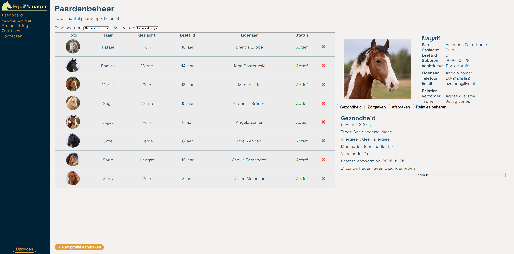
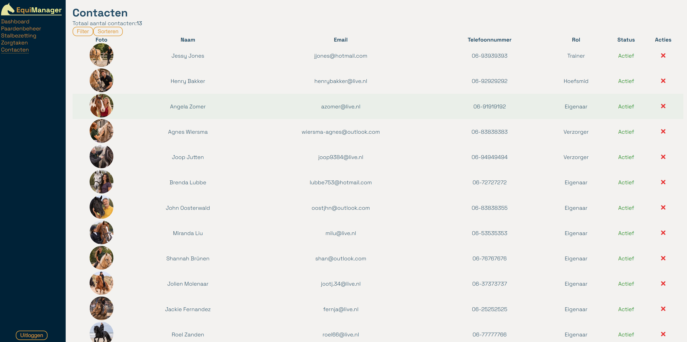
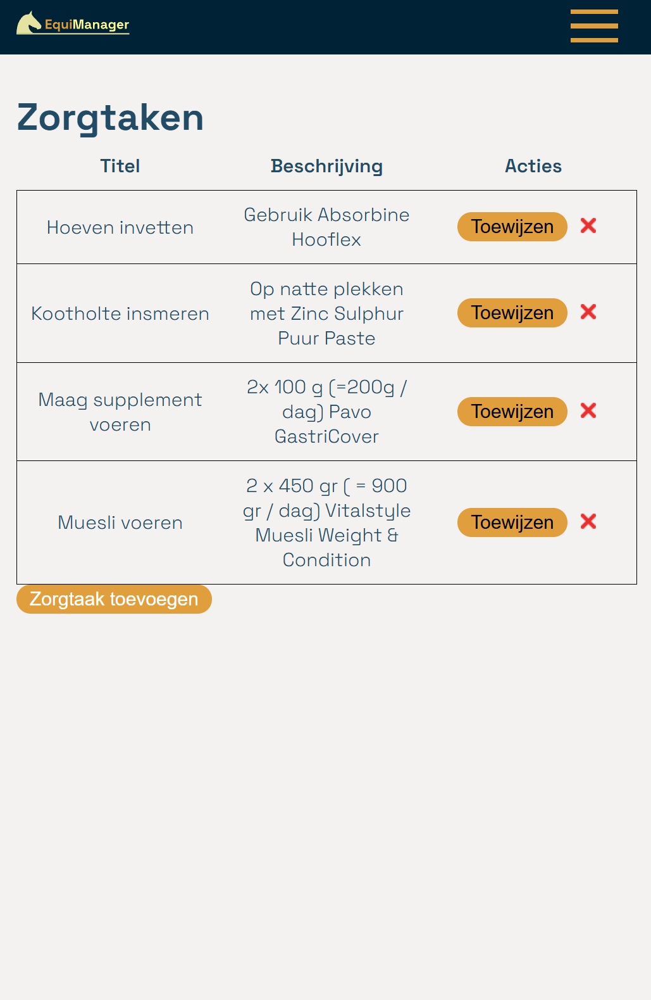
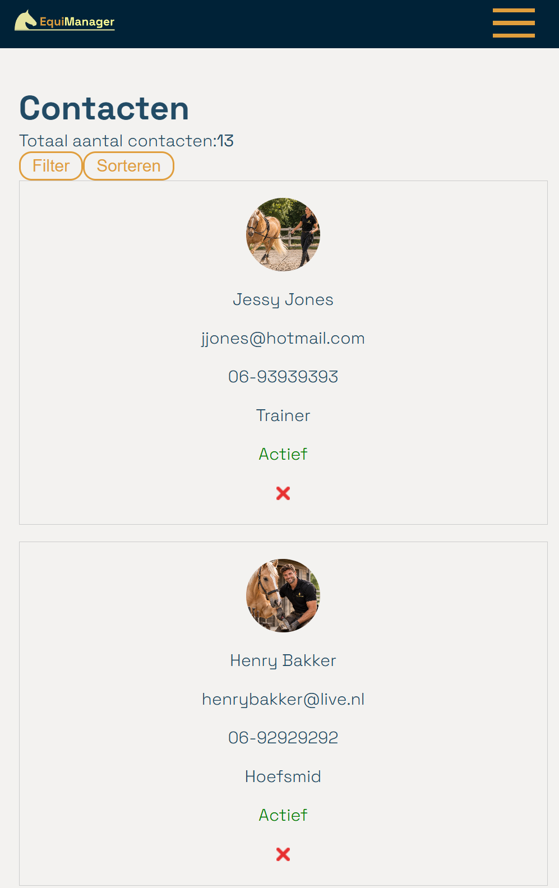
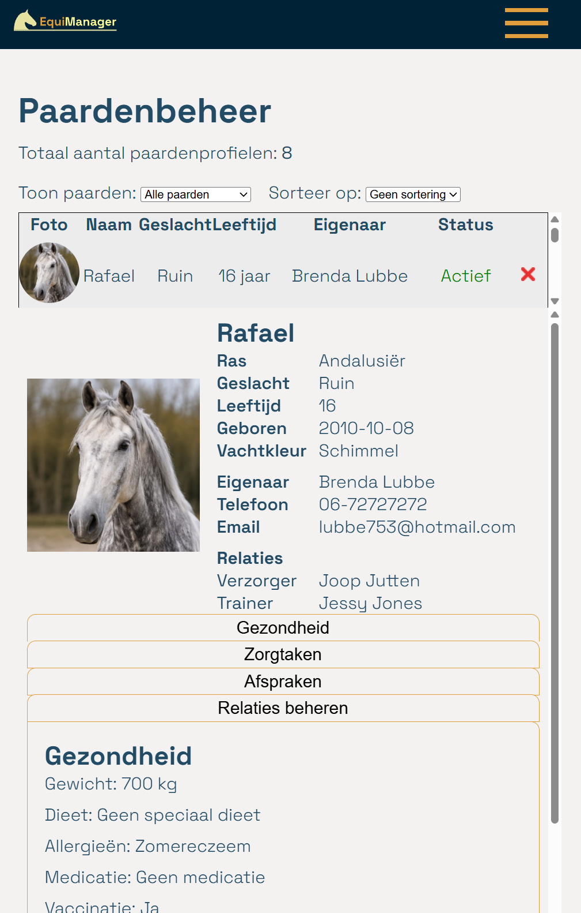

[Dutch version](README.md)

## EquiManager - Installation guide

---
## Table of contents
1. [Introduction](#1-introduction)
2. [Technologies and dependencies](#2-technologies-and-dependencies)
3. [Installation and running the application locally](#3-installation-and-running-the-application-locally)
4. [Available test account](#4-available-test-account)
5. [Available npm commands](#5-available-npm-commands)
---

## 1. Introduction
This application has been developed for stable owners to make managing horses and daily stable activities more organized and accessible. Users can manage horses, contacts and care tasks, link relationships and keep track of appointments.

The goal of the application is to bring all aspects of horse management together in one central location, allowing stable owners to easily keep track of their horses' health, care and planning.

### Features
- User registration and login
- Managing horses
- Managing stable occupancy
- Managing contacts
- Managing care tasks
- Linking contact profiles to multiple horse profiles
Managing appointments with professionals such as farriers and veterinarians
- Dashboard overview of the number of horses in the stable and pasture, outstanding appointments and care tasks.

#### Desktop screenshots

#### Mobile screenshots
   
---
## 2. Technologies and dependencies
EquiManager uses several libraries, frameworks and development tools.

### Authentication

**NOVI API**

EquiManager uses the NOVI API for authentication. This API handles the user registration and login processes and supports authentication within the application.

This allows users to register and log in to access the protected sections of EquiManager.

### Software requirements
The following software is required to install and run the application locally:

| Software | Version| Description|
|---|--------|------------|
|Git|Latest version|Used for cloning and managing the repository.|
|Node.js|v24.13.0|Used to run JavaScript outside the browser.|
|npm| v11.6.2 | Used to install and manage project dependencies.|

### Development environment
**Vite v8.1.6**

Vite is used as the development environment and build tool. It provides a fast development server during programming and can build the application for production.

### Frontend
**React v19.2.7**

The application is built with React. React was chosen because the application consists of many reusable components, such as forms, cards and sections. This makes it possible to develop and modify individual components separately.

The application uses several React Hooks:

| Hook | Description|
|---|---|
|`useState`| Used to manage local state within components.|
|`useEffect`|Used to handle side effects, such as fetching data from the API.|
|`useContext`|Used to share data between components without repeatedly passing it through props.|

**React DOM v19.2.7**

React DOM ensures that React components are rendered in the browser.

### Routing
**React Router DOM v7.18.1**

React Router DOM is used to manage the different pages within the application. It allows users to navigate between pages without having to reload the entire application.

### API
**Axios v1.18.1**

Axios is used to send HTTP requests to the backend, such as retrieving horse and contact data, creating appointments, updating relationships and saving care tasks.

### Styling
**CSS**

Most components have their own CSS file for styling.

---

## 3. Installation and running the application locally
Before installing the application, the following software must be available:

|Software| Version        |
|---|----------------|
|Git| Latest version |
|Node.js| v24.13.0       |
|npm| v11.6.2        |

**Step 1. Clone the repository** 

Clone the repository from GitHub using the following command:: `git clone git@github.com:WhitneyWassenaar/eindopdracht-whitneywassenaar-frontend-02-2026.git`

or

When you open your IDE, select `Clone Repository`, paste the project's SSH-key `git@github.com:WhitneyWassenaar/eindopdracht-whitneywassenaar-frontend-02-2026.git`, and open the project.

**Step 2. Install the required dependencies** 

Install the dependencies by entering `npm install` in the terminal and pressing Enter.

**Step 3. Configure environment variables**

The application uses a `.env` file to configure the connection to the backend. This file is not included in the GitHub repository. It is excluded from version control through `.gitignore`, so configuration data is not automatically uploaded to the repository.

Therefore, create a `.env` file in the root directory of the project.

Add the following configuration in .env:

`VITE_PROJECT_ID=project-ID`

Replace `project-ID` with the correct project ID associated with the backend.

**Step 5. Start the application**

1. Start the development server using the following command:: `npm run dev`

2. After starting the server, a local URL will appear in the terminal. Open this URL in your browser to use EquiManager.

<small>When submitting the final project, the `.env` file has been included.</small>

---

## 4. Available test account

A test account is available to view and test EquiManager. You can log in using this account through the application's login page.

**Login credentials:**

 Details       | Value                    |
|---------------|--------------------------|
| Email address | docent@novi-education.nl |
| Password      | `noviEducation@123`      |
---

## 5. Available npm commands

The following npm commands are available within EquiManager:

| Command | Description |
|---|---|
| `npm install` | Installs all required dependencies from the package.json file.                                           |
| `npm run dev` | Starts the development server, allowing the application to be viewed locally in the browser.                            |
| `npm run build` | Builds the application for production.                                                                               |
| `npm run preview` | Starts a local server to view and test the production build before publishing the application online.|
---

<small>All data used in the application is fictional and does not represent real individuals, horses, or organizations.</small>