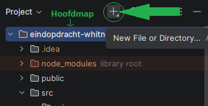
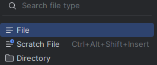

[English version](README-en.md)
# EquiManager handleiding

---
## Inhoudsopgave
1. [Inleiding](#1-inleiding)
2. [Gebruikte technieken en frameworks](#2-gebruikte-technieken-en-dependencies)
3. [Installatie en lokaal uitvoeren van de applicatie](#3-installatie-en-lokaal-uitvoeren-van-de-applicatie)
4. [Beschikbare testaccount](#4-beschikbare-testaccount)
5. [Beschikbare npm commando's](#5-beschikbare-npm-commandos)
---

## 1. Inleiding
Deze applicatie is ontwikkeld voor stalhouders om het beheer van paarden en dagelijkse werkzaamheden op stal overzichtelijk te maken. De gebruiker kan paarden, contacten en zorgtaken beheren, relaties koppelen en afspraken bijhouden.

Het doel van de applicatie is om alle onderdelen rondom paardenbeheer op één centrale plek samen te brengen zodat de stalhouder eenvoudig inzicht heeft in de gezondheid, verzorging en planning rondom paarden.

### Functionaliteiten
- Gebruikersregistratie en inloggen
- Beheren van paarden
- Beheren van stalbezetting
- Beheren van contacten
- Beheren van zorgtaken
- Contactprofielen koppelen aan (meerdere) paardenprofielen
- Beheren van afspraken met professionals zoals hoefsmeden en dierenartsen
- Dashboard-overzicht van aantal paarden op stal en in de wei, openstaande afspraken en zorgtaken.
---
## 2. Gebruikte technieken en dependencies
Voor het ontwikkelen en uitvoeren van EquiManager wordt gebruikgemaakt van verschillende libraries, frameworks en ontwikkeltools.

### Authenticatie

**NOVI API**

Voor de authenticatie binnen EquiManager wordt gebruikgemaakt van de NOVI API. Deze API verzorgt het registratie- en inlogproces van gebruikers en ondersteunt de authenticatie binnen de applicatie.

Hierdoor kunnen gebruikers zich registreren en inloggen om toegang te krijgen tot de beveiligde onderdelen van EquiManager.

### Softwarevereisten
De volgende software is nodig om de applicatie lokaal te kunnen installeren en uitvoeren:

| Software | Versie | Omschrijving|
|---|-------|---|
|Git|Nieuwste versie|Voor het clonen en beheren van de repository.|
|Node.js|v24.13.0|Voor het uitvoeren van JavaScript buiten de browser. |
|npm|v11.6.2|Voor het installeren en beheren van de projectdependencies.|

### Ontwikkelomgeving
**Vite v8.1.6**

Vite wordt gebruikt als ontwikkelomgeving en ontwikkeltool. Het biedt een snelle ontwikkelserver tijdens het programmeren en kan de applicatie omzetten naar een productieversie.

### Frontend
**React v19.2.7**

De applicatie is gebouwd met React. Er is gekozen voor React omdat de applicatie uit veel herbruikbare onderdelen bestaat zoals formulieren, kaarten en secties. Hierdoor kunnen onderdelen afzonderlijk aangepast worden.

Binnen de applicatie wordt er gebruikgemaakt van verschillende React Hooks:

| Hook | Omschrijving |
|---|---|
|`useState`| Voor het beheren van lokale state binnen componenten. |
|`useEffect` | Voor het uitvoeren van side effects, zoals het ophalen van gegevens uit de API. |
|`useContext` | Voor het delen van gegevens tussen componenten zonder deze steeds via props door te geven. |

**React DOM v19.2.7**

React DOM zorgt ervoor dat de React-componenten daadwerkelijk in de browser worden weergegeven.

### Routing
**React Router DOM v7.18.1**

React Router DOM wordt gebruikt om verschillende pagina's binnen de applicatie te beheren. Hierdoor kan de gebruiker tussen pagina's navigeren zonder dat de volledige applicatie opnieuw geladen hoeft te worden.

### API
**Axios v1.18.1**

Axios wordt gebruikt voor het versturen van HTTP-verzoeken naar de backend zoals het ophalen van gegevens van paarden, contacten of het aanmaken van afspraken, aanpassen van relaties en het opslaan van zorgtaken.

### Styling
**CSS**

De meeste componenten hebben een eigen CSS-bestand voor de styling.

---

## 3. Installatie en lokaal uitvoeren van de applicatie
Voordat de applicatie geïnstalleerd kan worden, moeten de volgende programma's aanwezig zijn:

|Software|Versie|
|---|---|
|Git|Nieuwste versie|
|Node.js|v24.13.0|
|npm|v11.6.2|

**Stap 1. Repository clonen**
Clone de repository vanaf GitHub met het volgende commando: `git clone git@github.com:WhitneyWassenaar/eindopdracht-whitneywassenaar-frontend-02-2026.git`

**Stap 2. Navigeren naar projectmap**
Open de terminal en navigeer naar de map van het project: `cd eindopdracht-whitneywassenaar-frontend-02-2026`

**Stap 3. Installeer de benodigde dependencies**
Installeer dependencies met: `npm install`

**Stap 4. Omgevingsvariabelen instellen**
De applicatie maakt gebruik van een .env-bestand voor de configuratie van de verbinding met de backend. Dit bestand is niet opgenomen in de GitHub-repository. Dit bestand wordt door `.gitignore` uitgesloten van versiebeheer, zodat configuratiegegevens niet automatisch worden meegestuurd naar de repository.

1. Maak daarom zelf een `.env`-bestand aan in de hoofdmap van het project.

    

2. Click op `File` en noem de file: `.env`

    

3. Voeg in de `.env`-bestand de volgende configuratie toe: 

   `VITE_PROJECT_ID=project-ID`

    Vervang `project-ID` door de juiste project-ID dat bij de backend hoort.

**Stap 5. Applicatie starten**
1. Start de ontwikkelserver met het volgende commando: `npm run dev`

2. Na het starten verschijnt er een lokaal adres in de terminal. Open dit adres in de browser om EquiManager te gebruiken.

<small>Bij het inleveren van de eindopdracht is de `.env` bestand wel toegevoegd.</small>

---

## 4. Beschikbare testaccount

Om EquiManager te kunnen bekijken en testen, is er een testaccount beschikbaar. Met dit account kan worden ingelogd via de inlogpagina van EquiManager.

**Inloggegevens:**

|Gegevens|Waarde|
|--------|---|
|E-mailadres|docent@novi-education.nl|
|Wachtwoord|`noviEducation@123`|
---

## 5. Beschikbare npm-commando's

Binnen EquiManager zijn de volgende npm-commando's beschikbaar:

| Commando | Omschrijving                                                                                                                     |
|---|----------------------------------------------------------------------------------------------------------------------------------|
| `npm install` | Installeert alle benodigde dependencies uit het `package.json`-bestand.                                                          |
| `npm run dev` | Start de ontwikkelserver, zodat de applicatie lokaal in de browser bekeken kan worden.                                           |
| `npm run build` | Bouwt de applicatie voor productie.                                                                                              |
| `npm run preview` | Start een lokale server om de gebouwde productieversie te bekijken en te testen voordat de applicatie online wordt gepubliceerd. |
---
